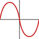

 <div id="logo" align="center">
    <br />
    
    <h1>baddy754</h1>
    <h3>Mega-fast math functions for CPU.</h3>
</div>

<div id="badges" align="center">

[](https://github.com/ntcd-lol/baddy754/releases)
[](https://github.com/ntcd-lol/baddy754/blob/main/LICENSE)
[](https://github.com/ntcd-lol/baddy754/commits/main)

</div>

# Baddy754 → Math in bytes

**baddy754** is an experimental header-only C++ math library built around IEEE 754 floating-point representation, bit manipulation, and low-level numerical techniques.

The idea is simple: instead of treating floating-point numbers as opaque values, baddy754 exposes their underlying representation and uses it to implement low-level operations.

The project currently focuses on basic floating-point manipulation and trigonometric functions.

> The library prioritizes experimentation with floating-point representations and performance-oriented techniques. Actual performance and numerical accuracy depend on the operation, compiler, target CPU, and input values.

## Features

- **IEEE 754 bit manipulation** — inspect and modify the bit patterns of `float` and `double`.
- **Sign operations** — absolute value, sign inversion, and sign copying.
- **Floating-point classification** — detect NaN, infinity, zero, normal, and subnormal values.
- **Exponent and mantissa access** — extract the underlying IEEE 754 fields.
- **Manual number construction** — build floating-point values from their sign, exponent, and mantissa.
- **Power-of-two scaling** — experimental exponent-based multiplication and division.
- **Normalization** — decompose finite, non-zero values into sign, exponent, and mantissa components, including subnormal inputs.
- **Trigonometry** — experimental `sin()` implementations for `float` and `double`.

## Requirements

- C++20 or later.
- A compiler and standard library supporting `std::bit_cast`.
- IEEE 754-compatible binary32 `float` and binary64 `double` representations for the bit layouts used by the library.

## Installation

baddy754 is header-only: there is no separate library binary to build.

Clone the repository:

```bash
git clone https://github.com/ntcd-lol/baddy754.git
```

Add the `include` directory to your compiler's include paths.

The public headers are located at:

```text
include/
└── B754/
    ├── basic.hpp
    └── trig.hpp
```

Include the functionality you need:

```cpp
#include <B754/basic.hpp>
#include <B754/trig.hpp>
```

## Quick start

```cpp
#include <iostream>

#include <B754/basic.hpp>
#include <B754/trig.hpp>

int main() {
    float x = 0.5f;

    auto raw_bits = baddy754::basic::bits(x);
    auto magnitude = baddy754::basic::abs(-x);
    auto sine = baddy754::trig::sin(x);

    std::cout << "Bits: " << raw_bits << '\n';
    std::cout << "Absolute value: " << magnitude << '\n';
    std::cout << "Sine: " << sine << '\n';
}
```

## Basic operations — `B754/basic.hpp`

The `baddy754::basic` namespace provides low-level operations on IEEE 754 floating-point values.

### Bit conversion

Convert between floating-point values and their integer bit representations without numeric conversion:

```cpp
float x = 1.0f;

uint32_t raw = baddy754::basic::bits(x);
float restored = baddy754::basic::from_bits(raw);
```

`bits()` exposes the raw binary representation. `from_bits()` interprets an integer bit pattern as a floating-point value.

These functions use `std::bit_cast`, avoiding the strict-aliasing problems associated with pointer reinterpretation.

### Sign operations

```cpp
baddy754::basic::abs(x);
baddy754::basic::neg(x);
baddy754::basic::copysign(magnitude, sign_source);
baddy754::basic::signbit(x);
```

These operations manipulate or inspect the sign bit directly.

### Classification

```cpp
baddy754::basic::isnan(x);
baddy754::basic::isinf(x);
baddy754::basic::isfinite(x);
baddy754::basic::iszero(x);
baddy754::basic::is_subnormal(x);
baddy754::basic::isnormal(x);
```

Classification is performed using the exponent and mantissa fields rather than relying on comparisons alone.

This matters for special values such as NaN, infinities, signed zeros, and subnormal numbers.

### Exponent and mantissa

```cpp
auto exponent = baddy754::basic::exponent(x);
auto mantissa = baddy754::basic::mantissa(x);
auto sign = baddy754::basic::sign(x);

int actual_exponent =
    baddy754::basic::unbiased_exponent(x);
```

`exponent()` returns the raw biased exponent field. `mantissa()` returns the stored fraction field without the implicit leading bit. `sign()` returns `0` or `1`.

`unbiased_exponent()` subtracts the format's exponent bias. For zero, subnormal values, and special values, interpret this result according to the actual representation rather than as a normalized scientific-notation exponent.

### Constructing and modifying values

```cpp
baddy754::basic::set_exponent(x, new_exponent);
baddy754::basic::set_mantissa(x, new_mantissa);

baddy754::basic::assemble(
    negative,
    unbiased_exponent,
    mantissa
);
```

`set_exponent()` accepts an unbiased exponent and preserves the original sign and mantissa fields. `set_mantissa()` replaces the stored fraction bits. `assemble()` combines a sign, an unbiased exponent, and a mantissa field into a floating-point representation.

These are low-level representation operations, not general-purpose numeric conversions. Inputs outside the supported exponent range can produce special or otherwise unintended bit patterns.

### Power-of-two scaling

```cpp
baddy754::basic::fast_mul2(x, n);
baddy754::basic::fast_div2(x, n);
```

These functions adjust the exponent field directly to scale a floating-point value by a power of two.

**Important:** these are experimental bit tricks, not fully checked replacements for multiplication and division. They do not implement normal IEEE 754 rounding, overflow, or underflow handling. Use them only when their representation-level preconditions are satisfied.

### Normalization

`normalize()` decomposes a finite, non-zero value into a sign, an unbiased exponent, and a mantissa with its implicit leading bit restored.

The resulting structures are:

- `NormalizedF` — the `float` representation.
- `NormalizedD` — the `double` representation.

Subnormal values are normalized by shifting their mantissa and decreasing the exponent. The resulting exponent may be below the normal range of the original format.

`from_normalized()` converts these structures back to the corresponding floating-point format, including handling exponent underflow and subnormal encoding. `denormalize()` provides a separate operation for forcing a normal value into a lower-exponent, subnormal-style representation.

These operations are intended for low-level floating-point experiments and should be tested carefully for the specific numerical requirements of an application.

## Trigonometric operations — `B754/trig.hpp`

<div align="center">
    
    <p><em>Sine function reference.</em></p>
</div>

The `baddy754::trig` namespace provides sine functions for `float` and `double`:

```cpp
float  baddy754::trig::sin(float x);
double baddy754::trig::sin(double x);
```

The input argument is measured in radians.

```cpp
#include <B754/trig.hpp>

int main() {
    float a = baddy754::trig::sin(0.5f);
    double b = baddy754::trig::sin(1.0);
}
```

The implementation combines IEEE 754 bit inspection, argument reduction, and polynomial approximation. The image above provides a visual reference for the sine function; it is not loaded or evaluated by the implementation at runtime.

### How `sin()` works

The current implementation combines floating-point bit inspection with numerical approximation:

1. **Inspect the representation.** Extract the sign, exponent, and fraction fields from the IEEE 754 bit pattern.
2. **Handle special values.** Preserve signed zero and return NaN for NaN or infinite inputs.
3. **Reduce the argument.** Use `std::remquo()` with an approximation of \(\pi/2\) to obtain a smaller remainder and information about the quotient.
4. **Select the trigonometric range.** Use the quotient's low bits to transform the remainder according to sine's periodicity and symmetry.
5. **Evaluate the kernel.** Approximate sine using a polynomial evaluated in a nested form.

The polynomial uses different coefficient sets for `float` and `double`, reflecting their different precision requirements.

### Accuracy and limitations

The current sine implementation is experimental.

In particular, reducing very large arguments using a rounded approximation of \(\pi/2\) can introduce substantial argument-reduction error. The implementation does not guarantee correctly rounded results or uniform accuracy across all representable inputs.

If your application requires strict numerical guarantees, validate the implementation against a trusted reference and consider a dedicated high-precision argument-reduction algorithm.

## Performance

baddy754 is designed to explore low-level math implementations and potential CPU performance improvements.

However, **“mega-fast” is a project goal, not a universal benchmark result**. Bit manipulation is not automatically faster than standard-library operations, and some operations may already be compiled into efficient machine instructions.

Meaningful performance comparisons should specify:

- CPU model and instruction-set support.
- Compiler and optimization flags.
- Input distribution and tested value ranges.
- Numerical error and edge-case behavior.
- Whether the benchmark measures throughput, latency, or both.

Benchmarks should compare baddy754 against the platform's standard math implementation using identical inputs and equivalent accuracy requirements.

## Project structure

```text
baddy754/
├── content/
│   ├── logo.svg
│   └── sin.bmp
├── include/
│   └── B754/
│       ├── basic.hpp
│       └── trig.hpp
├── LICENSE
└── README.md
```

- `content/logo.svg` — project logo.
- `content/sin.bmp` — sine-related project image.
- `include/B754/basic.hpp` — IEEE 754 primitives and floating-point manipulation.
- `include/B754/trig.hpp` — trigonometric functions.

## License

baddy754 is distributed under the MIT License. See [`LICENSE`](./LICENSE) for the full license text.

## Philosophy

> For people by people with love :heart: :3

Math is not always a black box. Sometimes, the interesting part is looking at the bits underneath.
